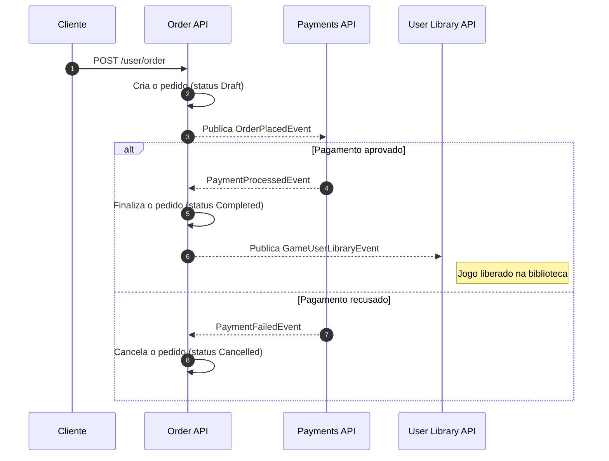

# Fiap Cloud Games (FCG) - Order API

Este microsserviço é responsável pelo **ciclo de vida dos pedidos de compra** de jogos na plataforma **Fiap Cloud Games (FCG)**. Desenvolvido em **.NET 9**, o projeto adota os princípios de **Clean Architecture** e **Domain-Driven Design (DDD)**, com separação explícita entre escrita e leitura (**CQRS**).

A Order API é o **orquestrador do fluxo de compra**: ela inicia a transação, aguarda o resultado do pagamento de forma assíncrona, libera o jogo na biblioteca do usuário e, em caso de falha na entrega, dispara a **compensação** que devolve o valor ao cliente.

---

## 🔄 Fluxo de Eventos e Responsabilidades

A comunicação com os demais microsserviços é assíncrona, via **RabbitMQ** (abstraído pelo **MassTransit**). O serviço possui tanto endpoints HTTP quanto *consumers* de eventos.



### 📥 Eventos Consumidos

| Evento | Origem | O que faz |
| :--- | :--- | :--- |
| `IPaymentProcessedIntegrationEvent` | Payments API | Finaliza o pedido e libera os jogos na biblioteca do usuário. |
| `IPaymentFailedIntegrationEvent` | Payments API | Cancela o pedido, encerrando o fluxo de compra. |
| `IGameCreatedIntegrationEvent` | Catalog API | Cria o *snapshot* local do jogo (nome, descrição, gênero, preço). |
| `IGameDeactiveIntegrationEvent` | Catalog API | Marca o jogo como indisponível para novas compras. |
| `IGameReactiveIntegrationEvent` | Catalog API | Devolve o jogo à disponibilidade. |

### 📤 Eventos Publicados

| Evento | Destino | Quando |
| :--- | :--- | :--- |
| `IOrderPlacedIntegrationEvent` | Payments API | Ao criar o pedido, solicitando o processamento do pagamento. |
| `IGameUserLibraryIntegrationEvent` | User Library API | Após o pagamento aprovado, para liberar cada jogo na biblioteca. |
| `IDeliveryFailedIntegrationEvent` | Payments API | Se a finalização do pedido falhar, para acionar o **estorno**. |

> [!IMPORTANT]
> **Compensação transacional (padrão Saga):** o pagamento é confirmado *antes* da entrega dos jogos. Se a finalização do pedido falhar depois disso, o cliente teria sido cobrado sem receber o produto. Para cobrir esse intervalo, o `FinalizeSucessOrderCommandHandler` captura a exceção e publica `IDeliveryFailedIntegrationEvent`, que faz a *Payments API* localizar a transação aprovada e registrar o reembolso.

### 🗂️ Snapshots Locais (Replicação por Eventos)

A Order API **não consulta a Catalog API** para saber nome ou preço de um jogo. Ela mantém uma cópia local (`GameSnapshot`) alimentada pelos eventos do catálogo. Isso elimina o acoplamento síncrono entre os serviços: um pedido pode ser criado mesmo com a Catalog API fora do ar, e o histórico preserva os dados do jogo como estavam no momento da compra.

---

## 🌐 Endpoints da API

| Método | Rota | Descrição |
| :--- | :--- | :--- |
| `POST` | `/api/user/order` | Realiza a compra de um game. |
| `GET` | `/api/user/order` | Obtém o histórico de pedidos do usuário. |

Ambos exigem autenticação **JWT**. Em execução pelo ecossistema completo, o acesso se dá pelo **Kong** em `http://localhost:8000/user/order` — o gateway valida o token e aplica rate limiting antes de encaminhar a requisição. A documentação **Swagger** fica disponível em `/swagger` quando a API é executada isoladamente.

### 🩺 Health Checks

| Rota | Uso |
| :--- | :--- |
| `/health/liveness` | O processo está de pé. |
| `/health/readiness` | Dependências (SQL Server e Redis) estão acessíveis. |

O `docker-compose.yml` do repositório de infraestrutura usa `/health/readiness` para liberar a subida do gateway.

---

## 📊 Métricas (Prometheus)

A API expõe métricas no formato Prometheus em `/metrics`, habilitadas por `app.UseHttpMetrics()` (duração, contagem e status code de cada rota, coletados automaticamente) e `app.MapMetrics()`.

Além das métricas HTTP padrão, há uma métrica de negócio customizada:

| Métrica | Tipo | Labels | Descrição |
| :--- | :--- | :--- | :--- |
| `order_attempts_total` | Counter | `result` (`success` \| `failure`) | Total de tentativas de criação de pedido, incrementada em `PlaceOrderCommandHandler`. |

---

## 🛠️ Tecnologias e Bibliotecas

- **.NET 9.0**: Framework principal para o desenvolvimento da API.
- **MongoDB (MongoDB.Driver)**: Banco de dados principal do domínio — armazena o agregado `Order`, `GameSnapshot` e `CustomerSnapshot`, tanto na escrita quanto na leitura (histórico paginado). Coleções e índices são criados automaticamente na subida da aplicação, sem migrations.
- **Entity Framework Core 9.0 + SQL Server**: não guarda dados de domínio; é usado exclusivamente pelo **Transactional Outbox/Inbox do MassTransit**, garantindo que a gravação do pedido e a publicação do evento de integração fiquem consistentes mesmo em caso de falha.
- **MediatR (v14)**: Implementação do padrão Mediator para desacoplamento e gerenciamento de comandos internos.
- **MassTransit**: Framework de mensageria que abstrai a comunicação com o **RabbitMQ**, com outbox baseado em EF Core, filtro de log de consumo e política de retry por endpoint.
- **Redis (StackExchange)**: Cache distribuído das consultas de histórico de pedidos.
- **Prometheus (prometheus-net.AspNetCore)**: Exposição de métricas HTTP e de negócio no formato Prometheus.
- **FluentValidation**: Validação declarativa dos comandos de entrada.
- **Serilog**: Logging estruturado em formato compacto.
- **xUnit & Moq**: Frameworks para construção e execução de testes unitários e de integração.

### 📦 Shared Kernels (Pacotes Compartilhados da FCG)
Projetos criados internamente e utilizados para padronizar e compartilhar recursos base:
- **Fcg.Core.Abstractions**: Biblioteca de blocos de construção para Domain-Driven Design (DDD) em projetos .NET.
- **Fcg.Core.Abstractions.Application**: Abstrações da camada de aplicação (comandos, resultados e contratos de caso de uso).
- **Fcg.Core.SharedContracts**: Contratos de eventos compartilhados para comunicação assíncrona entre os microsserviços da plataforma FCG.
- **Fcg.Core.WebApi**: Configurações compartilhadas de host, autenticação JWT, health checks e Serilog.

---

## 🏗️ Arquitetura da Solução

```
src/
├── Fcg.Orders.Domain         # Entidades de Domínio, ValueObjects e Interfaces
├── Fcg.Orders.Application    # Casos de Uso (Commands/Queries), DTOs e Handlers do MediatR
├── Fcg.Orders.Infrastructure # Acesso a Dados (MongoDB + Outbox EF Core/SQL Server), Consumers e Cache
└── Fcg.Orders.API            # Controllers, Middlewares e Inicialização (Program.cs)
```

### Detalhes das Camadas

#### 1. `Fcg.Orders.Domain` (Domínio)
Define o agregado `Order` com comportamentos ricos (`FinalizeOrder`, cancelamento) e o enum `OrderStatus` (`Draft`, `Completed`, `Cancelled`). Contém também o objeto de valor `Price` e as entidades de apoio `OrderGame` e `GameSnapshot`.

#### 2. `Fcg.Orders.Application` (Aplicação)
Separa os casos de uso em **Commands** (`PlaceOrderCommand`, `FinalizeSucessOrderCommand`, `FinalizeFailedCommand`) e **Queries** (`GetOrderHistoryQuery`). Concentra também os handlers dos eventos de integração recebidos do catálogo.

#### 3. `Fcg.Orders.Infrastructure` (Infraestrutura)
Persiste o agregado `Order`, `GameSnapshot` e `CustomerSnapshot` no **MongoDB** (escrita e leitura, incluindo a paginação do histórico). O **SQL Server**, acessado via `OrderDbContext` (EF Core), guarda apenas as tabelas `InboxState`, `OutboxState` e `OutboxMessage` do **Transactional Outbox do MassTransit** — o `UnitOfWork.CommitAsync()` grava o evento de integração no outbox como parte do mesmo `SaveChangesAsync` que confirma o processamento do comando. Contém ainda os **Consumers do MassTransit**, o filtro de log de consumo e o `RedisCacheService`.

#### 4. `Fcg.Orders.API` (Apresentação)
Ponto de entrada HTTP. Expõe os endpoints de pedido, o Swagger e os health checks, e inicializa a autenticação JWT.

---

## ⚙️ Configuração e Variáveis de Ambiente

Ao rodar localmente, preencha o `appsettings.json`:

```json
{
  "MongoDatabaseSettings": {
    "Host": "localhost", "Port": "27017", "DatabaseName": "Fcg_Orders",
    "Username": "admin", "Password": "SuaSenhaSegura"
  },
  "DatabaseSettings": {
    "Host": "localhost", "Port": "1433", "DatabaseName": "Fcg_Orders",
    "Username": "sa", "Password": "SuaSenhaSegura"
  },
  "RabbitMqSettings": {
    "Host": "localhost", "Port": "5672",
    "Username": "guest", "Password": "guest",
    "OrderPaymentSucceededQueue": "order-payment-succeeded",
    "OrderPaymentFailedQueue": "order-payment-failed",
    "GameCreatedIntegrationQueue": "order-game-created",
    "GameDeactiveIntegrationQueue": "game-deactive",
    "GameReactiveIntegrationQueue": "game-reactive"
  },
  "RedisSettings": {
    "Host": "localhost", "Port": "6379",
    "Password": "SuaSenhaRedis", "InstanceName": "FiapCloudGames:"
  },
  "JwtSettings": {
    "Secret": "chave-com-no-minimo-32-caracteres",
    "Issuer": "FiapCloudGames", "Audience": "FiapCloudGamesAudience"
  }
}
```

> [!NOTE]
> **MongoDatabaseSettings** guarda os dados de domínio (pedidos, snapshots de jogos e clientes) — coleções e índices são criados automaticamente na subida da aplicação (`EnsureMongoIndexesAsync`), sem migrations. **DatabaseSettings** aponta para o SQL Server usado exclusivamente pelas tabelas de Outbox/Inbox do MassTransit.

> [!WARNING]
> O `JwtSettings.Issuer` precisa ser **idêntico** ao configurado nos demais serviços e ao campo `key` do consumidor declarado no `kong.yml`. É por esse valor que o Kong localiza o segredo para validar a assinatura do token — uma divergência faz todas as rotas protegidas responderem `401` sem erro explicativo.

No **Docker Compose** e no **Kubernetes**, essas variáveis são injetadas via `.env`, `ConfigMaps` e `Secrets`, no formato `DatabaseSettings__Host`, `RabbitMqSettings__Port` e assim por diante.

---

## 🚀 Como Executar

### Opção 1: Ecossistema completo (recomendado)

Este microsserviço depende de MongoDB, SQL Server, RabbitMQ, Redis e dos demais serviços da FCG. A forma mais simples de executá-lo é pelo repositório de orquestração [fcg-infrastructure](https://github.com/alexoliveiraferreiradev/fcg-infrastructure), que sobe todo o ambiente com um único comando:

```bash
docker compose up -d
```

### Opção 2: Isoladamente

#### Pré-requisitos
- SDK do [.NET 9.0](https://dotnet.microsoft.com/download/dotnet/9.0) instalado.
- MongoDB, SQL Server, RabbitMQ e Redis em execução e acessíveis.

```bash
dotnet restore
dotnet build
```

```bash
dotnet ef database update --project src/Fcg.Orders.Infrastructure/ --startup-project src/Fcg.Orders.API/
```

> Esse comando cria apenas as tabelas de Outbox/Inbox do MassTransit no SQL Server. As coleções e índices do MongoDB (`orders`, `games`, `customers`) são criados automaticamente quando a API sobe.

```bash
dotnet run --project src/Fcg.Orders.API/
```

---

## ☸️ Implantação no Kubernetes (k8s)

Os manifestos locais deste serviço encontram-se na pasta `/k8s`:

```bash
kubectl apply -f k8s/
```

> [!TIP]
> **Migrações Automáticas:** o `migration.yaml` executa o `efbundle` como Job, garantindo que o schema esteja aplicado antes de a API começar a atender requisições.

---

## 🧪 Testes Automatizados

O repositório possui testes organizados na pasta `/tests`:
- **Fcg.Orders.Domain.Tests:** validam as regras do agregado `Order` e as transições de `OrderStatus`.
- **Fcg.Orders.Application.Tests:** cobrem a orquestração dos comandos e a correta publicação dos eventos de integração, incluindo o caminho de compensação.
- **Fcg.Orders.Application.IntegrationTests:** testes manuais do `PlaceOrderCommandHandler` contra uma instância real do MongoDB (`localhost:27017`, usuário `admin`). Não fazem parte da suíte padrão — exigem o Mongo acessível para rodar.

```bash
dotnet test
```
